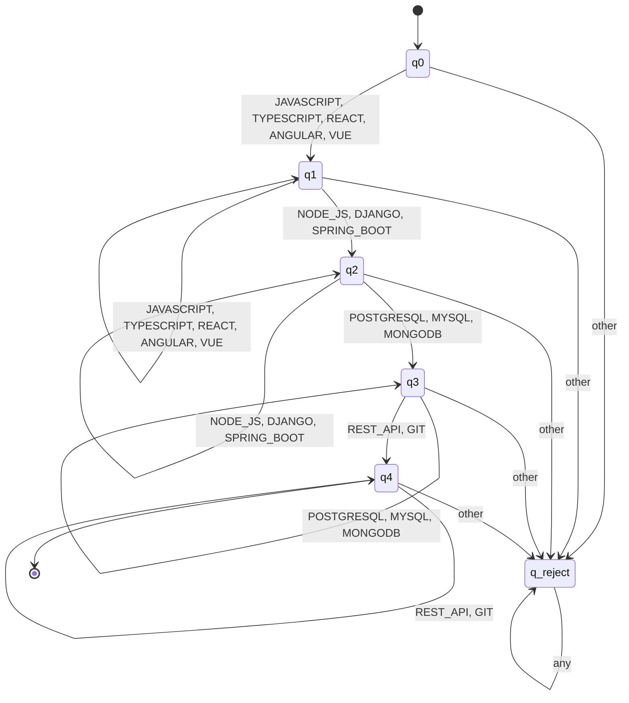
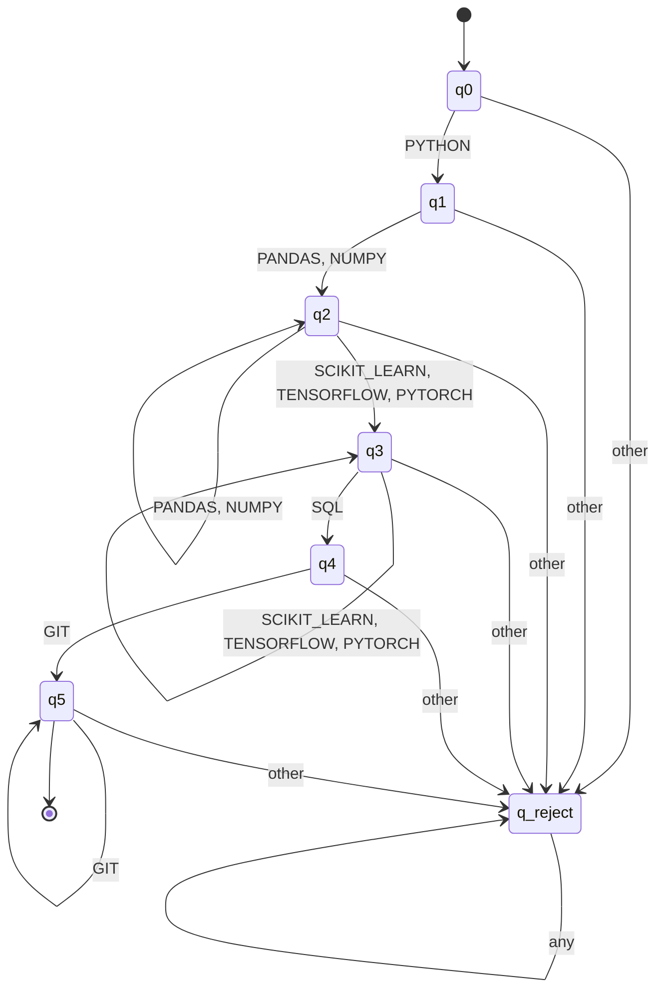
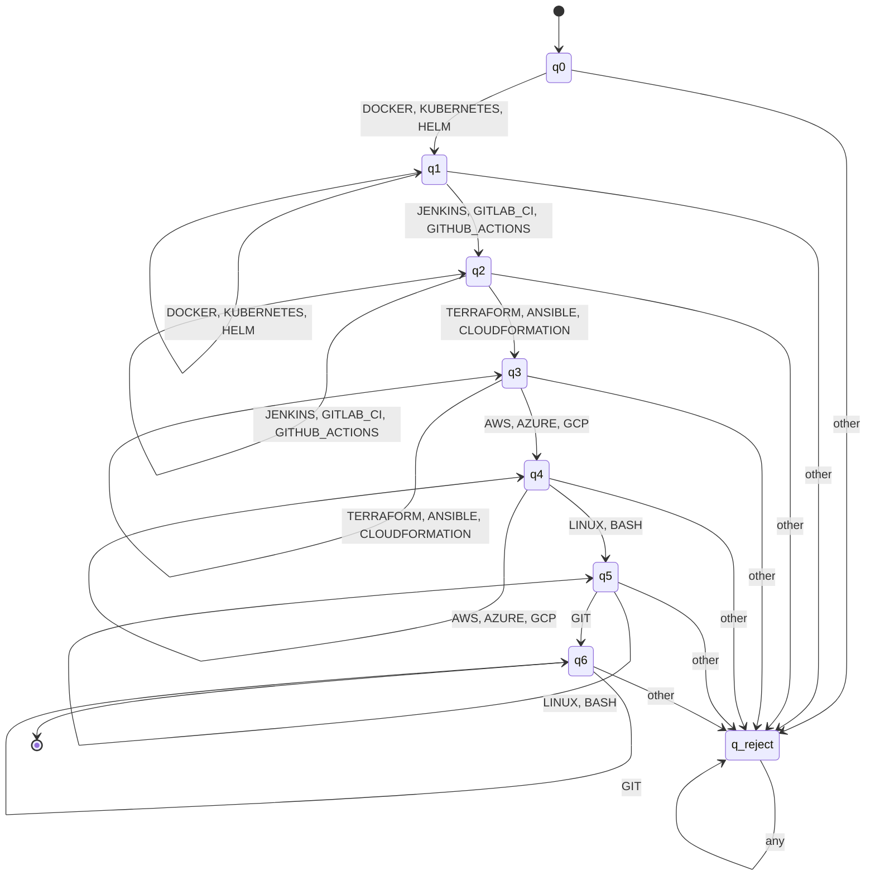
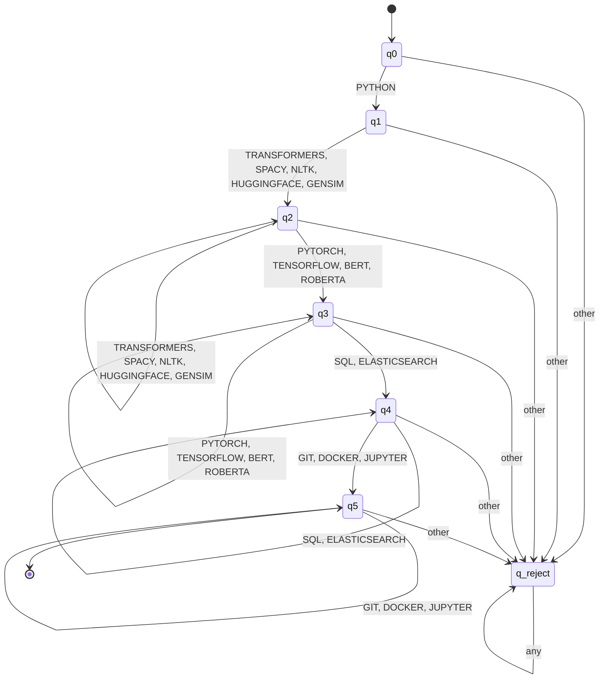

# Design Document — Automata and DSL for ResumeLens

## 1. Introduction

This document formalizes the qualification-pattern recognition stage and
the candidate-profile DSL of ResumeLens. It provides:

- The formal 5-tuple definition of each finite automaton used to
  recognize the four professional profiles.
- The type of automaton (DFA, NFA, or ε-NFA) with justification.
- Transition diagrams rendered with Mermaid.
- The EBNF grammar of the candidate-profile DSL, with explicit
  identification of terminals and non-terminals.
- A discussion of the structural characteristics of the language.

The automata operate over the **normalized and canonically ordered**
skill sequences produced by the FST stage. This ordering is essential:
it allows each DFA to process the input in a deterministic left-to-right
fashion without backtracking.

---

## 2. Finite Automata for Profile Recognition

### 2.1 Design Rationale

Each professional profile is modeled as a **Deterministic Finite
Automaton (DFA)**. The choice of DFA over NFA or ε-NFA is justified by
three factors:

1. **Canonical ordering.** The FST stage produces skills in a fixed
   category order (e.g., Frontend → Backend → Database → Tools for
   Full Stack). This eliminates the need for nondeterministic branching.
2. **Deterministic classification.** A candidate either satisfies the
   profile pattern or does not. There is no ambiguity that would
   require nondeterminism.
3. **Efficiency.** DFAs run in O(n) time with a single transition per
   input symbol, which is optimal for real-time screening.

Each DFA processes the skill sequence one token at a time. The automaton
accepts if and only if every required category is present in the correct
order. Any unexpected token drives the automaton to a rejecting sink
state.

---

### 2.2 Profile 1 — Full Stack Developer

#### 2.2.1 Profile Pattern

A Full Stack Developer must demonstrate competencies in four categories,
in this canonical order:

1. **Frontend** — JavaScript, TypeScript, React, Angular, Vue
2. **Backend** — Node.js, Django, Spring Boot
3. **Database** — PostgreSQL, MySQL, MongoDB
4. **Tools** — REST_API, Git

#### 2.2.2 Formal Definition (5-tuple)

**M_FS = (Q, Σ, δ, q₀, F)**

**Q** (set of states):
```
Q = {q₀, q₁, q₂, q₃, q₄, q_reject}
```
- q₀: initial state, no category consumed yet
- q₁: frontend category satisfied
- q₂: backend category satisfied
- q₃: database category satisfied
- q₄: tools category satisfied (accepting)
- q_reject: sink state for invalid transitions

**Σ** (input alphabet):
```
Σ = {JAVASCRIPT, TYPESCRIPT, REACT, ANGULAR, VUE,
     NODE_JS, DJANGO, SPRING_BOOT,
     POSTGRESQL, MYSQL, MONGODB,
     REST_API, GIT}
```

**δ** (transition function):

| Current state | Input symbol | Next state |
|---|---|---|
| q₀ | JAVASCRIPT, TYPESCRIPT, REACT, ANGULAR, VUE | q₁ |
| q₁ | JAVASCRIPT, TYPESCRIPT, REACT, ANGULAR, VUE | q₁ |
| q₁ | NODE_JS, DJANGO, SPRING_BOOT | q₂ |
| q₂ | NODE_JS, DJANGO, SPRING_BOOT | q₂ |
| q₂ | POSTGRESQL, MYSQL, MONGODB | q₃ |
| q₃ | POSTGRESQL, MYSQL, MONGODB | q₃ |
| q₃ | REST_API, GIT | q₄ |
| q₄ | REST_API, GIT | q₄ |
| any state | any symbol not listed above | q_reject |
| q_reject | any symbol | q_reject |

**q₀** (initial state): `q₀`

**F** (accepting states):
```
F = {q₄}
```

#### 2.2.3 Transition Diagram



#### 2.2.4 Example Trace

Input: `JAVASCRIPT, REACT, NODE_JS, POSTGRESQL, GIT`

| Step | State | Input | Next State |
|---|---|---|---|
| 0 | q₀ | JAVASCRIPT | q₁ |
| 1 | q₁ | REACT | q₁ |
| 2 | q₁ | NODE_JS | q₂ |
| 3 | q₂ | POSTGRESQL | q₃ |
| 4 | q₃ | GIT | q₄ |

Final state: **q₄ ∈ F** → **ACCEPTED**

---

### 2.3 Profile 2 — Machine Learning Engineer

#### 2.3.1 Profile Pattern

Canonical order:

1. **Core Language** — Python
2. **Data Processing** — Pandas, NumPy
3. **ML Library** — Scikit-learn, TensorFlow, PyTorch
4. **Data Access** — SQL
5. **Tools** — Git

#### 2.3.2 Formal Definition

**M_ML = (Q, Σ, δ, q₀, F)**

**Q**:
```
Q = {q₀, q₁, q₂, q₃, q₄, q₅, q_reject}
```

**Σ**:
```
Σ = {PYTHON, PANDAS, NUMPY, SCIKIT_LEARN, TENSORFLOW, PYTORCH, SQL, GIT}
```

**δ**:

| Current state | Input symbol | Next state |
|---|---|---|
| q₀ | PYTHON | q₁ |
| q₁ | PANDAS, NUMPY | q₂ |
| q₂ | PANDAS, NUMPY | q₂ |
| q₂ | SCIKIT_LEARN, TENSORFLOW, PYTORCH | q₃ |
| q₃ | SCIKIT_LEARN, TENSORFLOW, PYTORCH | q₃ |
| q₃ | SQL | q₄ |
| q₄ | GIT | q₅ |
| q₅ | GIT | q₅ |
| any state | other | q_reject |
| q_reject | any | q_reject |

**q₀**: `q₀`

**F**: `{q₅}`

#### 2.3.3 Transition Diagram



#### 2.3.4 Example Trace

Input: `PYTHON, PANDAS, SCIKIT_LEARN, TENSORFLOW, SQL, GIT`

| Step | State | Input | Next State |
|---|---|---|---|
| 0 | q₀ | PYTHON | q₁ |
| 1 | q₁ | PANDAS | q₂ |
| 2 | q₂ | SCIKIT_LEARN | q₃ |
| 3 | q₃ | TENSORFLOW | q₃ |
| 4 | q₃ | SQL | q₄ |
| 5 | q₄ | GIT | q₅ |

Final state: **q₅ ∈ F** → **ACCEPTED**

---

### 2.4 Profile 3 — DevOps Engineer (Team-Defined)

#### 2.4.1 Profile Pattern

Canonical order:

1. **Containers** — Docker, Kubernetes, Helm
2. **CI/CD** — Jenkins, GitLab_CI, GitHub_Actions
3. **IaC** — Terraform, Ansible, CloudFormation
4. **Cloud** — AWS, Azure, GCP
5. **OS** — Linux, Bash
6. **Tools** — Git

#### 2.4.2 Formal Definition

**M_DO = (Q, Σ, δ, q₀, F)**

**Q**:
```
Q = {q₀, q₁, q₂, q₃, q₄, q₅, q₆, q_reject}
```

**Σ**:
```
Σ = {DOCKER, KUBERNETES, HELM,
     JENKINS, GITLAB_CI, GITHUB_ACTIONS,
     TERRAFORM, ANSIBLE, CLOUDFORMATION,
     AWS, AZURE, GCP,
     LINUX, BASH,
     GIT}
```

**δ**:

| Current state | Input symbol | Next state |
|---|---|---|
| q₀ | DOCKER, KUBERNETES, HELM | q₁ |
| q₁ | DOCKER, KUBERNETES, HELM | q₁ |
| q₁ | JENKINS, GITLAB_CI, GITHUB_ACTIONS | q₂ |
| q₂ | JENKINS, GITLAB_CI, GITHUB_ACTIONS | q₂ |
| q₂ | TERRAFORM, ANSIBLE, CLOUDFORMATION | q₃ |
| q₃ | TERRAFORM, ANSIBLE, CLOUDFORMATION | q₃ |
| q₃ | AWS, AZURE, GCP | q₄ |
| q₄ | AWS, AZURE, GCP | q₄ |
| q₄ | LINUX, BASH | q₅ |
| q₅ | LINUX, BASH | q₅ |
| q₅ | GIT | q₆ |
| q₆ | GIT | q₆ |
| any state | other | q_reject |
| q_reject | any | q_reject |

**q₀**: `q₀`

**F**: `{q₆}`

#### 2.4.3 Transition Diagram



#### 2.4.4 Example Trace

Input: `DOCKER, KUBERNETES, JENKINS, TERRAFORM, AWS, LINUX, GIT`

| Step | State | Input | Next State |
|---|---|---|---|
| 0 | q₀ | DOCKER | q₁ |
| 1 | q₁ | KUBERNETES | q₁ |
| 2 | q₁ | JENKINS | q₂ |
| 3 | q₂ | TERRAFORM | q₃ |
| 4 | q₃ | AWS | q₄ |
| 5 | q₄ | LINUX | q₅ |
| 6 | q₅ | GIT | q₆ |

Final state: **q₆ ∈ F** → **ACCEPTED**

---

### 2.5 Profile 4 — NLP Engineer (Team-Defined)

#### 2.5.1 Profile Pattern

Canonical order:

1. **Core Language** — Python
2. **NLP Libraries** — Transformers, spaCy, NLTK, HuggingFace, Gensim
3. **Deep Learning** — PyTorch, TensorFlow, BERT, RoBERTa
4. **Data Access** — SQL, Elasticsearch
5. **Tools** — Git, Docker, Jupyter

#### 2.5.2 Formal Definition

**M_NLP = (Q, Σ, δ, q₀, F)**

**Q**:
```
Q = {q₀, q₁, q₂, q₃, q₄, q₅, q_reject}
```

**Σ**:
```
Σ = {PYTHON,
     TRANSFORMERS, SPACY, NLTK, HUGGINGFACE, GENSIM,
     PYTORCH, TENSORFLOW, BERT, ROBERTA,
     SQL, ELASTICSEARCH,
     GIT, DOCKER, JUPYTER}
```

**δ**:

| Current state | Input symbol | Next state |
|---|---|---|
| q₀ | PYTHON | q₁ |
| q₁ | TRANSFORMERS, SPACY, NLTK, HUGGINGFACE, GENSIM | q₂ |
| q₂ | TRANSFORMERS, SPACY, NLTK, HUGGINGFACE, GENSIM | q₂ |
| q₂ | PYTORCH, TENSORFLOW, BERT, ROBERTA | q₃ |
| q₃ | PYTORCH, TENSORFLOW, BERT, ROBERTA | q₃ |
| q₃ | SQL, ELASTICSEARCH | q₄ |
| q₄ | SQL, ELASTICSEARCH | q₄ |
| q₄ | GIT, DOCKER, JUPYTER | q₅ |
| q₅ | GIT, DOCKER, JUPYTER | q₅ |
| any state | other | q_reject |
| q_reject | any | q_reject |

**q₀**: `q₀`

**F**: `{q₅}`

#### 2.5.3 Transition Diagram



#### 2.5.4 Example Trace

Input: `PYTHON, TRANSFORMERS, SPACY, PYTORCH, SQL, GIT`

| Step | State | Input | Next State |
|---|---|---|---|
| 0 | q₀ | PYTHON | q₁ |
| 1 | q₁ | TRANSFORMERS | q₂ |
| 2 | q₂ | SPACY | q₂ |
| 3 | q₂ | PYTORCH | q₃ |
| 4 | q₃ | SQL | q₄ |
| 5 | q₄ | GIT | q₅ |

Final state: **q₅ ∈ F** → **ACCEPTED**

---

## 3. Candidate Profile DSL — Context-Free Grammar

### 3.1 Purpose

The DSL defines the **structured representation** of a candidate
profile produced by ResumeLens. It is not used for extraction or
classification — those stages produce the data that this DSL then
organizes. The grammar ensures that every candidate profile written
in the DSL is syntactically valid before being rendered as HTML.

### 3.2 EBNF Grammar

```ebnf
(* ===== Non-Terminals ===== *)
CandidateProfile = "CandidateProfile" "{"
                       PersonalInfo
                       [ Summary ]
                       { Experience }
                       { Skill }
                       Evaluation
                   "}" ;

PersonalInfo       = NameField EmailField [ LocationField ] [ RoleField ] ;
NameField          = "name" ":" STRING ;
EmailField         = "email" ":" STRING ;
LocationField      = "location" ":" STRING ;
RoleField          = "current_role" ":" STRING ;
Summary            = "summary" ":" STRING ;

Experience         = "Experience" "{"
                         CompanyField
                         DurationField
                         DescriptionField
                     "}" ;
CompanyField       = "company" ":" STRING ;
DurationField      = "duration" ":" STRING ;
DescriptionField   = "description" ":" STRING ;

Skill              = "Skill" ":" IDENTIFIER ;

Evaluation         = "Evaluation" "{"
                         ProfileField
                         ResultField
                         [ DescriptionField ]
                     "}" ;
ProfileField       = "profile" ":" STRING ;
ResultField        = "result" ":" ResultValue ;

(* ===== Terminals ===== *)
ResultValue        = "ACCEPTED" | "REJECTED" ;
IDENTIFIER         = /[A-Z][A-Z0-9_]*/ ;
STRING             = /"[^"]*"/ ;
```

### 3.3 Identification of Terminals and Non-Terminals

#### Non-Terminals (syntactic categories)

| Non-Terminal | Role |
|---|---|
| `CandidateProfile` | Root symbol of the grammar |
| `PersonalInfo` | Group of personal/contact fields |
| `NameField`, `EmailField`, `LocationField`, `RoleField` | Individual personal fields |
| `Summary` | Optional profile summary |
| `Experience` | Repeated block for work experience |
| `CompanyField`, `DurationField`, `DescriptionField` | Fields within Experience |
| `Skill` | Repeated skill token |
| `Evaluation` | Classification result block |
| `ProfileField`, `ResultField` | Fields within Evaluation |

#### Terminals (lexical tokens)

| Terminal | Lexical Pattern | Description |
|---|---|---|
| `CandidateProfile`, `Experience`, `Evaluation`, `Skill` | Keywords | Reserved words of the DSL |
| `name`, `email`, `location`, `current_role`, `summary`, `company`, `duration`, `description`, `profile`, `result` | Field names | Identifiers for fields |
| `:` | Punctuation | Field separator |
| `{`, `}` | Punctuation | Block delimiters |
| `ACCEPTED`, `REJECTED` | Enumeration literals | Only two valid result values |
| `STRING` | `/"[^"]*"/` | Double-quoted string |
| `IDENTIFIER` | `/[A-Z][A-Z0-9_]*/` | Canonical skill token |

### 3.4 Structural Characteristics of the Language

1. **Hierarchical structure.** The grammar is context-free and
   produces a tree rooted at `CandidateProfile`. Each block
   (`Experience`, `Evaluation`) is a subtree.

2. **Repetition.** The Kleene-closure operators `{ Experience }` and
   `{ Skill }` allow a candidate to have zero or more experiences
   and one or more skills. This is essential because résumés vary
   in length.

3. **Optional elements.** The brackets `[ Summary ]`,
   `[ LocationField ]`, `[ RoleField ]`, and `[ DescriptionField ]`
   mark optional components. This accommodates résumés that omit
   some information.

4. **Lexical discipline.** Skill tokens must match the `IDENTIFIER`
   pattern (uppercase letters, digits, underscores). This enforces
   that only **canonical** tokens produced by the FST stage can
   appear in a valid profile.

5. **Closed enumeration.** The `ResultValue` terminal is restricted
   to exactly two values: `ACCEPTED` and `REJECTED`. This prevents
   ambiguous or malformed classification results.

6. **Deterministic parsing.** The grammar is LL(1) — at each point,
   the next token uniquely determines the production to apply. This
   allows textX to parse it without backtracking.

### 3.5 Implementation with textX

The grammar above is implemented in `dsl/resume_dsl.tx` and loaded
by `dsl/parser.py` using `textx.metamodel_from_file()`. The textX
metamodel automatically generates Python classes for each
non-terminal, enabling object-oriented access to parsed profiles.

### 3.6 Validation and Rejection

The parser enforces syntactic rules via textX. Additional semantic
rules are enforced by `dsl/validator.py`, which checks:

- **Structural**: required fields (name, email, skills, evaluation)
- **Lexical**: email format, canonical skill tokens, duration format
- **Semantic**: valid profile names, consistent evaluation results

Profiles that violate any rule are **rejected** with a detailed
report listing all violations by category.

---

## 4. Summary of Formal Models Used

| Stage | Formal Model | Purpose |
|---|---|---|
| Extraction | Regular expressions | Identify information in raw text |
| Normalization | Finite-state transducers (7-tuple) | Map variations to canonical tokens |
| Classification | Deterministic finite automata (5-tuple) | Recognize profile patterns |
| Specification | Context-free grammar (EBNF) | Structure the candidate profile |

Each model was chosen because it matches the computational nature of
its stage: regex for pattern matching, FST for string-to-string
transformation, DFA for sequence recognition, and CFG for hierarchical
structure.

---

## 5. References

- Hopcroft, J. E., Motwani, R., & Ullman, J. D. (2006).
  *Introduction to Automata Theory, Languages, and Computation*.
  Pearson.
- textX documentation. https://textx.github.io/textX/
- pyformlang documentation. https://pyformlang.readthedocs.io/